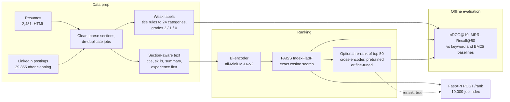

# job-match-ranker

[](https://github.com/byteKumar/job-match-ranker/actions/workflows/tests.yml)

Ranks job postings for a resume with sentence embeddings and FAISS, and measures how much this beats keyword matching.

## Results at a glance

Full write-up, error analysis and raw outputs: [RESULTS.md](RESULTS.md).

- Embedding retrieval raises nDCG@10 from 0.253 (keyword matching) and 0.277 (BM25) to 0.427, on 48 held-out resumes x 894 graded jobs.
- Re-ranking the top 50 with a cross-encoder made ranking worse (0.319). Fine-tuning it on 300 weakly labeled pairs did not help (0.316 ± 0.002 over 3 seeds).
- The FastAPI service ranks 10,000 jobs per request: p50/p99 17.7/23.1 ms on a quiet machine (CPU, 1 client).
- Labels are weak: a blind 100-pair check agreed 50% exactly (Cohen's kappa 0.247). An AI did that check, not a person.

## Architecture



| module | role |
|---|---|
| `src/jobmatch/data.py`, `clean.py` | load the raw CSVs, parse resume HTML into sections, clean and de-duplicate postings, build the embedding text |
| `src/jobmatch/categories.py`, `labels.py` | map job titles to the 24 resume categories, grade pairs, build the train / test / hand-check sets |
| `src/jobmatch/lexical.py` | keyword-share and BM25 baselines, matched-skill highlighting |
| `src/jobmatch/neural.py` | bi-encoder, FAISS index, cross-encoder re-ranker |
| `src/jobmatch/metrics.py`, `evalset.py` | nDCG@10, MRR, Recall@50 over the graded test pool |
| `src/jobmatch/service.py` | FastAPI app: `/health`, `/rank` |
| `scripts/` | data prep, evaluation, fine-tuning, index build, latency test, error analysis, label check |

## Approach

**Design decisions**

| decision | why | trade-off |
|---|---|---|
| Bi-encoder + exact FAISS flat index | Jobs are embedded once; a query is one embedding and one search. At 10k x 384 the index is 15.4 MB. | No approximate index (IVF, HNSW): fine at 10k jobs, would need one and a recall check at millions. |
| Section-aware embedding text | The model reads only 256 tokens, so title, skills, summary and experience go first. | Measured against raw text, it is a wash. Putting skills first also caused one real failure (a skills list starting with "banking"). |
| Weak labels from categories | No human relevance labels exist for this data. Job titles map to the resume dataset's 24 categories; same category = 2, related = 1, else 0. | Cheap and covers every pair, but noisy: grades 1 and 2 often disagree with a reader. |
| Cross-encoder re-rank kept optional | It reads resume and job together, which should be more accurate. | With it, p50 latency is 1,613.1-1,947.4 ms instead of 17.7-31.3 ms, and it ranked worse offline, so `rerank` is off by default. |
| Fixed fine-tuning hyperparameters | 3 epochs, lr 2e-5, batch 16, fixed before evaluation; no dev set, no early stopping. | Avoids tuning on the test set, at the cost of never searching for better settings. |

**Evaluation method**

- Fully graded test pool: 48 held-out test resumes (2 per category) are each scored against all 894 eval-corpus jobs, so 42,912 graded pairs. No ranked job is unjudged.
- Train and test never share a resume, and training pairs never use eval-corpus jobs. A test enforces both.
- Metrics fixed before any model ran: nDCG@10 with gains 2^g - 1; MRR and Recall@50 count grade 2 as relevant.
- Fine-tuning ran with 3 seeds (0, 1, 2); the table reports mean ± sample std. Every other number is one evaluation pass.
- Label quality: a blind, stratified 100-pair check (labeled by an AI subagent, not a person).
- Machine: Apple M3 (16 GB), macOS 26.6, Python 3.12.10, PyTorch 2.15.0, sentence-transformers 6.3.0, faiss-cpu 1.16.0, FastAPI 0.163.1. Evaluation and training on MPS; the service on CPU.

## Results

**Ranking quality** (48 test resumes x 894 jobs)

| model | nDCG@10 | MRR | Recall@50 |
|---|---|---|---|
| random | 0.058 | 0.122 | 0.053 |
| keyword (PepperUni-style) | 0.253 | 0.366 | 0.177 |
| BM25 | 0.277 | 0.369 | 0.200 |
| bi-encoder, raw text (ablation) | 0.419 | 0.539 | 0.313 |
| **bi-encoder (section-aware text)** | **0.427** | **0.543** | **0.280** |
| bi-encoder + pretrained cross-encoder re-rank | 0.319 | 0.365 | 0.280 |
| bi-encoder + fine-tuned re-rank (3 seeds) | 0.316 ± 0.002 | 0.378 ± 0.004 | 0.280 ± 0.000 |

Recall@50 is the same for all re-rank rows by construction: re-ranking only reorders the top 50.

Why re-ranking loses, checked on training pairs only: the pretrained cross-encoder tracks the grade poorly (Spearman 0.229), and fine-tuning only brings it to the bi-encoder's level (0.427 vs 0.414), even on the pairs it trained on.

**Service latency** (10,000 jobs, uvicorn 1 worker on CPU, 1 sequential client)

| run | mode | requests | p50 | p99 |
|---|---|---|---|---|
| 1 (overlapped another project's benchmark) | retrieval only | 1,000 | 31.3 ms | 776.3 ms |
| 1 | retrieval + re-rank top 50 | 300 | 1,947.4 ms | 7,071.1 ms |
| 2 (quiet machine) | retrieval only | 1,000 | 17.7 ms | 23.1 ms |
| 2 (load rose to 7.2 during the run) | retrieval + re-rank top 50 | 300 | 1,613.1 ms | 2,726.0 ms |

In run 2, embedding the resume takes most of the time (median 16.0 ms); FAISS search takes 0.27 ms. Index build: 45.4 s (embedding on MPS), index 15.4 MB.

## How to run

```bash
python3.12 -m venv .venv
.venv/bin/pip install --no-cache-dir -r requirements.txt
scripts/fix_libomp.sh                     # macOS only: faiss-cpu and torch each bundle libomp

# data (not committed): ~56 MB + ~135 MB
mkdir -p data/raw/resumes data/raw/jobs
curl -L -o data/raw/resumes/Resume.csv https://huggingface.co/datasets/opensporks/resumes/resolve/main/Resume/Resume.csv
curl -L -o data/raw/jobs/job_postings.csv https://huggingface.co/datasets/xanderios/linkedin-job-postings/resolve/main/job_postings.csv

.venv/bin/python scripts/prepare_data.py                   # clean data, build the labeled sets
.venv/bin/python scripts/evaluate.py random keyword bm25 biencoder_raw biencoder biencoder_rerank
for s in 0 1 2; do .venv/bin/python scripts/train_crossencoder.py --seed $s; done
.venv/bin/python scripts/evaluate.py finetuned
.venv/bin/python scripts/error_analysis.py
.venv/bin/python scripts/build_index.py                    # 10k-job FAISS index
.venv/bin/python scripts/latency_test.py --label myrun     # starts uvicorn on :8010
```

Models (~91 MB each) download into `.hf-cache/` inside the project. Serve and query:

```bash
.venv/bin/uvicorn jobmatch.service:app --app-dir src --port 8010
curl -s localhost:8010/rank -H 'content-type: application/json' \
  -d '{"resume_text": "Staff Accountant\nSkills\nGL, reconciliations, Excel", "k": 5}'
```

`/rank` takes `resume_text`, `k` (1-50, default 10) and `rerank` (default false), and returns the top k jobs with the job keywords found in the resume.

On macOS, `fix_libomp.sh` points faiss at torch's OpenMP runtime so only one copy loads. Without it, a process that runs torch on the CPU and imports faiss dies with `OMP: Error #15` (or hangs). `KMP_DUPLICATE_LIB_OK=TRUE` is not used: OpenMP documents it as unsafe. On Linux, faiss and torch load together without the fix (CI checks this).

## Tests and CI

```bash
.venv/bin/python -m pytest -q
```

36 tests cover the title rules, HTML cleaning, label-set leakage and density, metrics, the FAISS index, the bi-encoder and the `/rank` endpoint. Locally, the data and model tests skip until `prepare_data.py` has run and the model is downloaded.

CI ([`.github/workflows/tests.yml`](.github/workflows/tests.yml), ubuntu-latest, CPU-only PyTorch):

1. Downloads the two datasets and the bi-encoder.
2. Rebuilds the labeled sets and checks they match the committed `results/dataset_stats.json`.
3. Runs all 36 tests with `JOBMATCH_STRICT_TESTS=1`, so any skipped test fails the run.

CI does not re-run the evaluations, training or benchmarks; those numbers come from the Mac above. [Latest runs](https://github.com/byteKumar/job-match-ranker/actions/workflows/tests.yml); first green run: [43928519348](https://github.com/byteKumar/job-match-ranker/actions/runs/43928519348).

## Limitations

- **Weak labels.** Grades come from category rules, not human judgments. Grade 0 is reliable; grades 1 and 2 are noisy. 9 of the 10 worst test queries are resumes whose dataset category does not match their content, so absolute scores are understated. Small gaps (section-aware vs raw text, the two re-rankers) are within what label noise could move.
- **The 100-pair label check was done by an AI, not a person.** It agreed 50% exactly (kappa 0.247). `scripts/handcheck.py` is ready for a human check of the same pairs.
- **Re-ranking hurt.** Both cross-encoders ranked worse than the bi-encoder alone. Fixes worth trying (on a dev split from training resumes): cleaner labels, hard negatives from the bi-encoder's own candidates, and blending the two scores.
- **Latency.** Run 1 overlapped another project's benchmark on this shared Mac (p99 776.3 ms) and did not save per-request timings. Run 2 was a quiet diagnostic re-run (p99 23.1 ms). Both are reported. Only one sequential client was tested; there is no concurrency or throughput test.
- **No confidence intervals.** Every metric is one evaluation pass over 48 queries (the fine-tuned row is 3 training seeds).
- **Short skills are not highlighted.** `matched_skills` drops tokens under 3 characters ("GL", "QA") and does no stemming.
- Fine-tuned checkpoints for seeds 1 and 2 were deleted to save disk; `scripts/train_crossencoder.py --seed 1` / `--seed 2` re-creates them.
- No experiment tracker (MLflow); results are the tables in RESULTS.md and JSON files in `results/`.

## Data and licenses

Data, model weights and indexes are not committed.

- Resumes: [Resume Dataset](https://www.kaggle.com/datasets/snehaanbhawal/resume-dataset) by Snehaan Bhawal, CC0 (Public Domain), via the Hugging Face mirror `opensporks/resumes`. Resumes are anonymized by the dataset, but a few still contain names or profile URLs, so no resume text is committed; committed results contain ids, categories and short titles only.
- Jobs: [LinkedIn Job Postings (2023-2024)](https://www.kaggle.com/datasets/arshkon/linkedin-job-postings) by Arsh Koneru, CC BY-SA 4.0, via the Hugging Face mirror `xanderios/linkedin-job-postings` (2023 snapshot, `job_postings.csv`).
- Models: `sentence-transformers/all-MiniLM-L6-v2` and `cross-encoder/ms-marco-MiniLM-L6-v2`, both Apache-2.0.

Interview notes per milestone, with one exercise each: [docs/INTERVIEW_NOTES.md](docs/INTERVIEW_NOTES.md).
